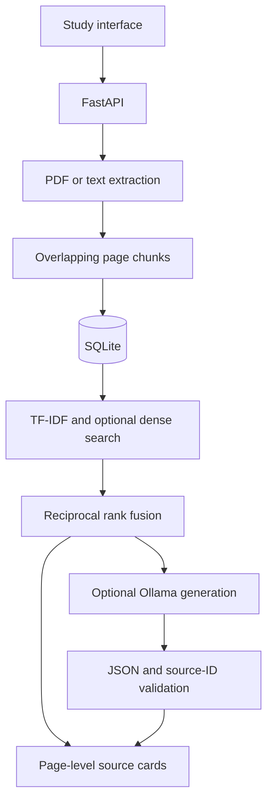

# ◈ StudyLens

**Turn your lecture notes into a source-backed study companion.**

StudyLens is a local-first AI/ML portfolio project: upload PDF, TXT, or Markdown notes, retrieve relevant passages, and optionally generate grounded explanations with a local language model. The default demo runs without an API key, paid service, GPU, or model download.

## What you can do

- Upload and persist notes in SQLite; remove them from the interface.
- Ask questions and inspect the exact passage and original PDF page.
- Run lexical retrieval immediately, then enable dense semantic retrieval with Sentence Transformers.
- Fuse lexical and semantic rankings using reciprocal rank fusion (RRF).
- Generate schema-constrained explanations through **Ollama + Qwen3.5**, with source-ID validation and an explicit extraction fallback.
- Explore a responsive, accessible study interface and interactive FastAPI API docs.

> Default mode retrieves text; it does **not** run a neural model or generate explanations. Enable the optional AI features below to run the complete RAG pipeline.

## Run in 3 minutes

Requirements: Python 3.11+ (3.12 recommended). Run from the repository root.

```bash
git clone https://github.com/AdarshVasth/studylens.git
cd studylens
python -m venv .venv
source .venv/bin/activate
# Windows PowerShell: .venv\Scripts\Activate.ps1
pip install .
uvicorn app.main:app --reload
```

Open **http://127.0.0.1:8000**. Click **Try with sample OS notes**, then ask “What causes a context switch?” Expand source cards to inspect the evidence. API docs: **http://127.0.0.1:8000/docs**.

The application is designed to run from the cloned repository, which includes the bundled demo data.

## Enable local language generation

Install [Ollama](https://ollama.com), start it, and download the default model:

```bash
ollama pull qwen3.5:4b
ollama serve
```

If the Ollama desktop app is already serving, skip `ollama serve`. Restart StudyLens if you change environment variables, then enable **Generate an explanation with local Ollama** in the UI. Model downloads need internet and disk space; generation speed depends on RAM, CPU/GPU, and model size. Choose a smaller compatible model using `OLLAMA_MODEL` if needed.

```bash
export OLLAMA_MODEL=qwen3.5:4b
export OLLAMA_URL=http://localhost:11434
uvicorn app.main:app --reload
```

The prompt treats retrieved notes as untrusted data. Pydantic validates the structured JSON answer, and the app rejects unknown/missing citation IDs. These checks validate reference syntax, **not factual entailment**: verify generated statements against the passages. A failed local model call or invalid citation returns retrieved passages with a visible warning.

## Enable semantic retrieval

```bash
pip install '.[semantic]'
export STUDYLENS_SEMANTIC=1
uvicorn app.main:app --reload
```

First semantic query downloads `sentence-transformers/all-MiniLM-L6-v2` from Hugging Face. The model is a lightweight CPU-friendly baseline, chosen for practicality. `encode_query` and `encode_document` also support newer compatible embedding models; set `STUDYLENS_EMBEDDING_MODEL` to experiment. Corpus embeddings are cached in memory and rebuilt after document changes.

Hybrid mode combines TF-IDF cosine similarity with dense cosine similarity via `1 / (60 + rank)`. Dense results below 0.25 cosine similarity are omitted. This threshold is a heuristic, not a calibrated confidence score. Displayed rank scores are retrieval scores, never answer probabilities.

## Architecture



| Component | Technology | Purpose |
| --- | --- | --- |
| API | FastAPI, Pydantic | Typed routes and response validation |
| Lexical ML | scikit-learn TF-IDF | Explainable baseline search |
| Dense retrieval | Sentence Transformers | Optional semantic similarity |
| Local LLM | Ollama, configurable Qwen3.5 | Optional generated explanations |
| Storage | SQLite | Persistent notes, no cloud database |
| Frontend | HTML, CSS, JavaScript | Small responsive UI, no build step |
| Quality | unittest, Ruff, GitHub Actions | Regression checks and retrieval evaluation |

## Tests and evaluation

```bash
pip install '.[dev]'
ruff check app tests
python -m unittest discover -s tests -v
python -m app.evaluate
```

The test suite covers uploads, invalid documents, size limits, storage, deletion, page provenance, retrieval ranking, embedding-cache invalidation, generated answers, model failure, and invalid-citation fallback. Neural encoder and Ollama integrations are mocked in automated tests; real model quality and runtime compatibility must be verified on your machine.

The bundled **five-question OS retrieval smoke benchmark** reports hit@1. It is deliberately tiny and overlaps with demo content; it is not evidence of general accuracy. Expand it with held-out queries before making quality claims. No trained weights, real student files, or fabricated benchmark numbers are included.

## Docker

```bash
docker build -t studylens .
docker run --rm -p 127.0.0.1:8000:8000 -v studylens-data:/app/runtime studylens
```

The image includes the baseline only. Optional semantic dependencies require a custom image. To use Ollama on the Docker host, configure `OLLAMA_URL` with a host address reachable from the container (Linux may need `--add-host=host.docker.internal:host-gateway`). Model installation is separate from this image.

## Configuration

See [.env.example](.env.example). Export variables in your shell; `.env` is not loaded automatically.

| Variable | Default |
| --- | --- |
| `STUDYLENS_DATA` | `runtime` |
| `STUDYLENS_SEMANTIC` | `0` |
| `STUDYLENS_EMBEDDING_MODEL` | `sentence-transformers/all-MiniLM-L6-v2` |
| `OLLAMA_URL` | `http://localhost:11434` |
| `OLLAMA_MODEL` | `qwen3.5:4b` |

`uv.lock` records dependency resolution if using uv: `uv sync --locked --extra dev` and `uv run uvicorn app.main:app --reload`.

## Practical boundaries

- **Single-user, localhost application.** No accounts, tenant isolation, rate limiting, or production hardening. Do not expose it publicly as-is.
- All local browser users share the same library. Uploaded notes persist in `runtime/notes.db`; deleting a document removes its database row but is not forensic secure erasure.
- At most 40 documents, 8 MB per upload, 100 PDF pages, and 1.5 million extracted chunk characters per document. Scanned/image-only or encrypted PDFs are unsupported; use OCR first.
- TF-IDF is rebuilt per query and dense vectors live in memory: intended for small personal collections, not a vector database replacement.
- Default runtime makes no cloud AI API calls. Fonts may load from Google Fonts; model downloads contact model registries. Ollama requests go to your configured endpoint. Offline use works with system fonts and previously downloaded local models.
- No live model, GPU, Docker build, or deployment is implied by passing offline tests.

## Learn and extend

Read [docs/LEARNING_GUIDE.md](docs/LEARNING_GUIDE.md) for the core concepts and an interview walkthrough. Good next contributions: OCR, a held-out retrieval benchmark, reranking, authentication, and per-user document storage.

## Technology references

- [FastAPI uploads](https://fastapi.tiangolo.com/tutorial/request-files/)
- [Sentence Transformers semantic search](https://www.sbert.net/examples/sentence_transformer/applications/semantic-search/README.html)
- [Ollama structured outputs](https://ollama.com/blog/structured-outputs)
- [Qwen3.5 model catalog](https://ollama.com/library/qwen3.5:4b)

MIT licensed. Review and customize the implementation before presenting it as your own engineering experience.
